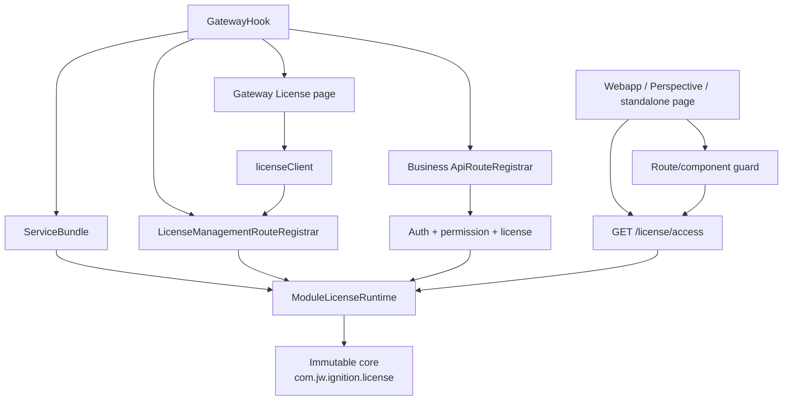

# License 整合与旧 SDK 项目迁移指南

## 1. 使用方式

本文档不依赖 Git history、commit、branch 或未提交 diff。

执行迁移时只需要：

```text
SOURCE_REPO = 当前 ignition-sdk-boilerplate 源代码目录
TARGET_REPO = 需要整合 License 的旧 SDK 项目目录
```

本文所有 source path 均相对于 `SOURCE_REPO`。目标 agent 必须直接读取当前 source file，再复制或语义合并到 `TARGET_REPO`。

执行原则：

1. `Copy exact`：复制当前 source file 内容；只做本文明确允许的 module-specific substitution。
2. `Merge exact`：目标文件已有业务代码；逐项加入本文列出的字段、constructor、method、route、export 或 wrapper，不整文件覆盖。
3. `Conditional prerequisite`：目标项目缺少当前 boilerplate 已有基础设施时，先从当前 source 移植对应基础设施，再继续 License 整合。
4. 不从记忆重写，不重新设计，不用另一套实现替代。
5. 最终以当前 source behavior 为验收标准。

---

## 2. 必须达到的结果

- `base/src/main/java/com/jw/ignition/license/` 完整复制、零修改。
- Custom License runtime 由一个 lifecycle owner 管理。
- Management plane 在 unlicensed 状态仍可访问。
- Business API 默认要求 Licensed；feature requirements 可显式声明 all/any。
- Webapp route、navigation、局部组件、standalone page 使用同一 requirement semantics。
- 目标项目每个后台业务任务在执行前检查 License。
- License 管理页是 Ignition Gateway native mounted React page。
- 页面 HTML 内容、UI、CSS、labels、按钮和 JavaScript 行为保持当前 source 原样。
- 不注册 legacy `GET /license/page`。
- 不使用 iframe。
- `GatewayHook.isFreeModule()` 保持 `true`；Custom RSA License 与 Ignition native module licensing 分离。

安全顺序：

```text
Backend request:
authenticated / permission
-> license requirement
-> handler

Frontend route:
authenticated
-> permission
-> license requirement
-> page/component
```

---

## 3. Runtime 架构



三层边界：

| 层 | Source path | 责任 | 迁移规则 |
|---|---|---|---|
| Immutable core | `base/src/main/java/com/jw/ignition/license/` | verify、file store、machine match、upload、audit、models、legacy renderer | 整目录原样复制 |
| Reusable integration | `base/src/main/java/com/jw/ignition/common/license/` | lifecycle、refresh、expiry、requirements、safe snapshot、route wrapping | 原样复制 |
| Module wiring | `gateway/`、`common/`、`web-ui/` | module identity、permission、routes、page mount、frontend guards | 按本文精确合并 |

---

## 4. 完整 Source 文件清单

### 4.1 Immutable core：26 个文件，全部 Copy exact

复制整个目录最安全：

```text
SOURCE_REPO/base/src/main/java/com/jw/ignition/license/
->
TARGET_REPO/base/src/main/java/com/jw/ignition/license/
```

完整 manifest：

```text
base/src/main/java/com/jw/ignition/license/audit/LicenseAuditService.java
base/src/main/java/com/jw/ignition/license/api/LicenseGateFilter.java
base/src/main/java/com/jw/ignition/license/api/LicenseRouteRegistrar.java
base/src/main/java/com/jw/ignition/license/api/LicenseRoutes.java
base/src/main/java/com/jw/ignition/license/crypto/RsaPublicKeys.java
base/src/main/java/com/jw/ignition/license/enums/LicenseStatusCode.java
base/src/main/java/com/jw/ignition/license/exception/LicenseAccessException.java
base/src/main/java/com/jw/ignition/license/exception/LicenseFeatureAccessException.java
base/src/main/java/com/jw/ignition/license/exception/LicenseUploadException.java
base/src/main/java/com/jw/ignition/license/model/IdentifierMatchModel.java
base/src/main/java/com/jw/ignition/license/model/LicenseFileModel.java
base/src/main/java/com/jw/ignition/license/model/LicenseModuleModel.java
base/src/main/java/com/jw/ignition/license/model/LicensePayloadModel.java
base/src/main/java/com/jw/ignition/license/model/LicenseStatusModel.java
base/src/main/java/com/jw/ignition/license/model/LicenseVerifierConfigModel.java
base/src/main/java/com/jw/ignition/license/model/MachineInfoModel.java
base/src/main/java/com/jw/ignition/license/model/MachineInfoRequestModel.java
base/src/main/java/com/jw/ignition/license/model/MachineInfoSnapshotModel.java
base/src/main/java/com/jw/ignition/license/page/LicensePageRenderer.java
base/src/main/java/com/jw/ignition/license/service/LicenseFileStoreService.java
base/src/main/java/com/jw/ignition/license/service/LicenseVerifierService.java
base/src/main/java/com/jw/ignition/license/service/MachineInfoService.java
base/src/main/java/com/jw/ignition/license/service/ModuleLicenseService.java
base/src/main/java/com/jw/ignition/license/state/CachedLicenseState.java
base/src/main/java/com/jw/ignition/license/upload/LicenseMultipartUploadParser.java
base/src/main/java/com/jw/ignition/license/upload/LicenseUpload.java
```

禁止修改：

- package name。
- class/method/field names。
- RSA public key。
- verifier、schema、signature、algorithm、module ID、expiry、machine matching logic。
- upload、file store、audit、model semantics。
- `LicensePageRenderer` 的 HTML/CSS/JavaScript。

`LicenseRouteRegistrar`、`LicenseGateFilter`、`LicensePageRenderer` 继续保留在 core，但标准整合不会实例化 legacy registrar。

### 4.2 新增 integration files：18 个

#### Backend reusable integration：5 个 Copy exact

```text
base/src/main/java/com/jw/ignition/common/license/LicenseAccessSnapshot.java
base/src/main/java/com/jw/ignition/common/license/LicenseRequirement.java
base/src/main/java/com/jw/ignition/common/license/ModuleLicenseRuntime.java
base/src/test/java/com/jw/ignition/common/license/LicenseAccessSnapshotTest.java
base/src/test/java/com/jw/ignition/common/license/LicenseRequirementTest.java
```

Package 保持：

```text
com.jw.ignition.common.license
```

#### Gateway wiring：2 个 Copy exact + package substitution

```text
gateway/src/main/java/com/jw/ignitionsdkboilerplate/gateway/license/LicenseAccessRoutes.java
gateway/src/main/java/com/jw/ignitionsdkboilerplate/gateway/license/LicenseManagementRouteRegistrar.java
```

允许修改：

```text
com.jw.ignitionsdkboilerplate.gateway.license
-> target module gateway package
```

类内容和 route behavior 不改。

#### Frontend shared layer：5 个 Copy exact

```text
web-ui/src/components/foundation/StandaloneLicenseGuard.tsx
web-ui/src/lib/api/license.ts
web-ui/src/lib/api/licenseClient.ts
web-ui/src/lib/query/license.ts
web-ui/src/lib/types/api/license.ts
```

目标项目 alias 不是 `@/` 时，只允许机械调整 import path；logic 不改。

#### Gateway License page：3 个 Copy exact

```text
web-ui/src/packages/page/license/LicensePage.module.css
web-ui/src/packages/page/license/LicensePage.tsx
web-ui/src/packages/page/license/index.ts
```

只允许修改：

```text
LicensePage.tsx 中 MODULE_NAME fallback
```

不得修改 layout、labels、CSS、actions 或 request flow。

#### Webapp License guard：3 个 Copy exact

```text
web-ui/src/packages/webapp/components/auth/AppLicenseGuard.tsx
web-ui/src/packages/webapp/pages/Auth/LicenseRequiredPage.tsx
web-ui/src/packages/webapp/query/license.ts
```

### 4.3 既有文件：16 个 Merge exact

以下表格是完整 integration delta。目标 agent 必须逐行完成。

| Source file | 必须合并的确切内容 |
|---|---|
| `base/src/main/java/com/jw/ignition/common/api/AbstractApiRouteRegistrar.java` | 增加 License fields、3 种 constructor、License-aware `json`/`binary` overload、`html` compatibility helper、统一 `mount(...)` 的 requirement 参数、default requirement resolution、`license.wrap(...)`、缺 runtime 时 fail-fast |
| `common/src/main/java/com/jw/ignitionsdkboilerplate/common/ModuleConstants.java` | `WebPackages` 增加 `LICENSE_PAGE_EXPORT_NAME`；值必须与 frontend named export 完全一致 |
| `gateway/src/main/java/com/jw/ignitionsdkboilerplate/gateway/GatewayHook.java` | 注册 `LicenseManagementRouteRegistrar`；business registrar 注入 `services.license()`；在既有 `pageJsModule` 增加 License Gateway page；保持 `isFreeModule() == true` |
| `gateway/src/main/java/com/jw/ignitionsdkboilerplate/gateway/api/ApiRouteRegistrar.java` | constructor 接收 `ModuleLicenseRuntime`；调用含 runtime 的 `super(...)`；business route 使用 `LicenseRequirement`；当前 health 明确 `licensed()` |
| `gateway/src/main/java/com/jw/ignitionsdkboilerplate/gateway/auth/AppPermission.java` | 增加 `LICENSE_MANAGE = "license.manage"` 和对应 `AppPermissionDef` |
| `gateway/src/main/java/com/jw/ignitionsdkboilerplate/gateway/service/ServiceBundle.java` | 增加单一 `ModuleLicenseRuntime` field；setup/startup/shutdown wiring；增加 non-null `license()` accessor |
| `web-ui/src/lib/api/index.ts` | `createAuthBaseApi` tag types 增加 `LicenseAccess`、`LicenseStatus` |
| `web-ui/src/lib/types/api/index.ts` | 增加 `export * from "./license"` |
| `web-ui/src/packages/page/counter/CounterPage.tsx` | 用 `StandaloneLicenseGuard requiredLicense` 包裹 `CounterPageContent`，作为 standalone page 标准示例 |
| `web-ui/src/packages/page/index.ts` | export `LicensePage` 为 module-specific named export；名字与 Java constant 一致 |
| `web-ui/src/packages/webapp/api/index.ts` | import `injectLicenseEndpoints`；在 auth API 后注入并 export `licenseApi` |
| `web-ui/src/packages/webapp/App.tsx` | 查询 License access；route 传 `requiredLicense` 和 `LicenseRequiredPage`；navigation group/item 同时按 permission + License evaluator 递归过滤 |
| `web-ui/src/packages/webapp/app/appRoutes.tsx` | import `RequiredLicense`；route flatten/navigation builder 加 inheritance；root default `true`；业务 route 声明 required License/features |
| `web-ui/src/packages/webapp/components/auth/RouteGuard.tsx` | 增加 License props/types；permission 成功后进入 `LicenseGuard`；loading/error/deny renderer；复用统一 evaluator |
| `web-ui/src/packages/webapp/pages/index.ts` | export `LicenseRequiredPage` |
| `web-ui/src/packages/webapp/types/appRoutes.ts` | `AppRouteDefinition`、`NavigationItem`、`NavigationGroup` 增加 `requiredLicense?: RequiredLicense` |

Documentation 和 project version 不属于 runtime integration，不需要从 source 项目复制。

---

## 5. Conditional prerequisites

以下不是额外 License 设计；它们是当前 source 已有、License wiring 依赖的基础设施。

### 5.1 Backend prerequisites

目标项目必须已有或移植：

```text
base/src/main/java/com/jw/ignition/common/service/AbstractRuntimeService.java
base/src/main/java/com/jw/ignition/common/service/AbstractBundle.java
base/src/main/java/com/jw/ignition/common/api/ApiErrorHandler.java
base/src/main/java/com/jw/ignition/common/api/ApiException.java
base/src/main/java/com/jw/ignition/common/api/ApiResponses.java
base/src/main/java/com/jw/ignition/auth/
```

Build dependency 以当前 source 的 `base/build.gradle` 为参考。目标至少需要等价的 Ignition common/Gateway SDK compile classpath 和 JUnit test setup。当前 License integration 没有引入额外第三方 backend dependency。

如果目标 route framework 与 source 不同，必须实现相同契约：

- auth/permission 在 License 前执行。
- business registrar 有 default Licensed。
- management registrar 无 custom License default。
- License failures 经统一 JSON error wrapper 返回。

不得通过修改 `com.jw.ignition.license` 兼容旧 framework。

### 5.2 Frontend prerequisites

目标项目必须已有或移植：

- React runtime。
- RTK Query API instance。
- runtime API base。
- authenticated request credentials。
- Perspective identity headers（若目标有 Perspective）。
- Gateway CSRF token logic。
- webapp route metadata / navigation tree。
- page bundle target。

### 5.3 Page bundle prerequisite

当前 source 的 page target 定义位于：

```text
web-ui/scripts/build-targets.mts
```

关键 contract：

```ts
page: {
  entryFilename: "page.js",
  libName: "<ModuleSpecificPageLibraryName>",
  libEntry: "./src/packages/page/index.ts",
}
```

目标已有 `page.js` target：不新增第二套 target。

目标没有 page target：移植当前 source 的 page target/build pipeline，再按本文 mount License page。

---

## 6. Backend 精确契约

### 6.1 `LicenseRequirement`

Backend declaration：

```java
LicenseRequirement.licensed();
LicenseRequirement.allFeatures("report.export", "report.schedule");
LicenseRequirement.anyFeatures("report.basic", "report.pro");
```

Semantics：

| Match | 要求 |
|---|---|
| `LICENSED` | status 必须 licensed，不检查 feature |
| `ALL` | status licensed，且全部 required features 存在 |
| `ANY` | status licensed，且至少一个 required feature 存在 |

Feature normalization：trim、lowercase、dedupe、保持首次出现顺序。

Invalid declarations：

- `LICENSED` 带 feature -> `IllegalArgumentException`。
- `ALL` / `ANY` 无 feature -> `IllegalArgumentException`。
- null/blank feature -> `IllegalArgumentException`。

### 6.2 `LicenseAccessSnapshot`

Safe access response 只能包含：

```text
licensed
code
message
verifiedAt
expiresAt
features
```

禁止包含：

```text
licensePath
machine identifiers
identifier match details
完整 payload/management fields
```

Null status 必须 fail-closed：`licensed = false`、empty features。

### 6.3 `ModuleLicenseRuntime`

Constructor：

```java
new ModuleLicenseRuntime(
    context,
    ModuleConstants.MODULE_ID,
    ModuleConstants.MODULE_NAME,
    ModuleConstants.MOUNT_ALIAS
)
```

Lifecycle：

```text
setup
  -> new ModuleLicenseService(context, moduleId, mountAlias)

startup
  -> revalidate("startup")
  -> single daemon monitor
  -> initial delay 5 seconds
  -> fixed delay 5 seconds

shutdown
  -> shutdownNow monitor
  -> clear monitor
  -> clear service
```

Thread name：

```text
<mountAlias>-license-monitor
```

`refresh()`：

```text
revalidateIfFileChanged()
-> licensed status expired or expiry unparseable
-> revalidate("expiry")
```

`allows(requirement)`：access/feature exception 或其他 runtime error 均返回 `false`；unexpected error 记录 warning。

`require(requirement)`：不满足时抛 immutable core exceptions；满足时返回当前 status。

`wrap(requirement, handler)`：

| Failure | HTTP | Error code |
|---|---:|---|
| Module 未 licensed | 403 | `MODULE_UNLICENSED` |
| Features 不满足 | 403 | `FEATURE_NOT_LICENSED` |

Feature error details：`requiredFeatures`、`match`、safe License snapshot。

### 6.4 `AbstractApiRouteRegistrar`

Source constructor roles：

```java
// Control plane: no default License requirement.
super(context, auth, routePrefix);

// Business plane: default LicenseRequirement.licensed().
super(context, auth, routePrefix, licenseRuntime);

// Framework extension: explicit default requirement.
super(context, auth, routePrefix, licenseRuntime, defaultRequirement);
```

`json(...)` / `binary(...)` 必须同时保留：

- 既有无 License 参数 overload。
- 新增显式 `LicenseRequirement` overload。
- `AccessControlStrategy` overload。

Effective requirement：

```text
explicit route requirement
?? registrar default requirement
```

Requirement 非 null 但 runtime 为 null：

```text
IllegalStateException("Licensed route requires ModuleLicenseRuntime.")
```

Guard composition：

```text
handler
-> license.wrap
-> authFilter.authenticated / authFilter.require
-> ApiErrorHandler.wrap
```

实际执行：auth/permission -> license -> handler。

`html(...)` helper 必须保留，使 immutable legacy registrar 可编译；标准 `GatewayHook` 不调用它。

### 6.5 `ServiceBundle`

唯一正确顺序：

```text
setupProcess:
  construct + setup License runtime
  construct + setup AuthCore

startupProcess:
  license.startup()
  auth.startup()

shutdownProcess:
  auth.shutdown(); auth = null
  license.shutdown(); license = null
```

一个 module instance 只允许一个 runtime/monitor。

### 6.6 Permission

Target `AppPermission` 增加：

```java
public static final String LICENSE_MANAGE = "license.manage";
```

Catalog：

```java
new AppPermissionDef(
    LICENSE_MANAGE,
    "License:Manage",
    "View status, upload, and revalidate the module license"
)
```

Permission 与 feature 不同：

- permission 控制用户能否管理 License。
- feature 控制当前 License 是否允许业务能力。

### 6.7 Management routes

`LicenseManagementRouteRegistrar` 必须使用无 custom License default constructor：

```java
super(context, auth, routePrefix);
```

Routes：

| Method | Path | Auth | Permission | Ignition access control | Handler |
|---|---|---|---|---|---|
| GET | `/license/access` | required | none | open route + custom auth | `LicenseAccessRoutes.access` |
| GET | `/license/status` | required | `license.manage` | Web UI READ | refresh + core status |
| GET | `/license/machine-request` | required | `license.manage` | Web UI READ | core machine request |
| POST | `/license/upload` | required | `license.manage` | Web UI CSRF READ | core upload |
| POST | `/license/revalidate` | required | `license.manage` | Web UI CSRF READ | core revalidate |

`/license/access` 使用 safe snapshot。其他四个为 management surface。

不创建：

```java
new LicenseRouteRegistrar(...)
```

不 mount：

```text
GET /license/page
```

### 6.8 Business routes

每个 target business registrar constructor 注入 runtime：

```java
public ApiRouteRegistrar(
    GatewayContext context,
    AuthCore auth,
    ModuleLicenseRuntime license,
    String moduleVersion
) {
    super(context, auth, ModuleConstants.API_PREFIX, license);
}
```

Licensed-only endpoint：

```java
json(
    routes,
    HttpMethod.GET,
    "/reports",
    true,
    AppPermission.REPORT_ACCESS,
    LicenseRequirement.licensed(),
    reportRoutes::list
);
```

All features：

```java
LicenseRequirement.allFeatures("report.export", "report.schedule")
```

Any feature：

```java
LicenseRequirement.anyFeatures("report.basic", "report.pro")
```

Registrar default Licensed 是漏写保护；显式 declaration 用于可读性和 feature gating。

### 6.9 Background tasks

当前 source 提供 gate API，不存在自动全局 task interceptor。

目标 agent 必须找出每个 scheduler、poller、worker、subscription、driver loop、queue consumer，并在每轮业务动作前：

```java
if (!services.license().allows(
        LicenseRequirement.allFeatures("report.schedule")
)) {
    return;
}
```

或调用 `require(...)` 并在 task boundary 终止业务动作。

### 6.10 `GatewayHook`

`mountRouteHandlers(...)`：

```java
new AuthRouteRegistrar(...).register(routes);

new LicenseManagementRouteRegistrar(
    context,
    services.auth(),
    services.license(),
    ModuleConstants.API_PREFIX,
    ModuleConstants.MODULE_NAME,
    ModuleConstants.MOUNT_ALIAS,
    AppPermission.LICENSE_MANAGE
).register(routes);

new ApiRouteRegistrar(
    context,
    services.auth(),
    services.license(),
    moduleVersion()
).register(routes);
```

保持：

```java
@Override
public boolean isFreeModule() {
    return true;
}
```

---

## 7. Frontend 精确契约

### 7.1 Types

```ts
type RequiredLicense =
  | false
  | true
  | {
      features: readonly [string, ...string[]];
      match?: "all" | "any";
    };
```

Mapping：

| Backend | Frontend |
|---|---|
| `licensed()` | `true` |
| `allFeatures("a", "b")` | `{ features: ["a", "b"] }` |
| `anyFeatures("a", "b")` | `{ features: ["a", "b"], match: "any" }` |
| Control plane 无 custom License gate | `false`，仅当 route 确实属于 webapp control plane |

Feature key 在 Java、TypeScript、License generator 中必须相同。推荐 lowercase dotted keys。

### 7.2 RTK Query wiring

`createAuthBaseApi` tag types：

```text
LicenseAccess
LicenseStatus
```

Endpoints：

```text
licenseAccess:      GET  /license/access
licenseStatus:      GET  /license/status
revalidateLicense:  POST /license/revalidate
```

Injection order：

```text
baseApi -> healthApi -> authApi -> licenseApi
```

Default access polling：

```text
5000 ms
```

共享 evaluator：

```text
undefined / false -> allow
status not licensed -> deny
true + licensed -> allow
match any -> at least one feature
match omitted/all -> all features
```

### 7.3 Route metadata

下列 interface 都增加：

```ts
requiredLicense?: RequiredLicense;
```

- `AppRouteDefinition`
- `NavigationItem`
- `NavigationGroup`

Flatten/navigation inheritance root default：

```ts
inheritedLicense: RequiredLicense = true
```

Child 未声明时继承 parent。

当前 source 示例：

| Route | Requirement |
|---|---|
| Home | `{ features: ["core"], match: "all" }` |
| Dummy tree | parent `core`，children 继承 |
| Deep dummy child | `{ features: ["core", "sub"], match: "all" }` |
| Settings | `true` |
| Permission Control | 继承 Settings `true` + `authorization.manage` |

迁移旧项目时不要复制 `dummy/core/sub` 业务示例；对目标真实 routes 使用相同 declaration mechanism 和目标 License feature catalog。

当前 source 没有 `requiredLicense: false` route example。License management page 是独立 Gateway page，不在 webapp route tree 内。

### 7.4 `App.tsx`

读取 access status：

```ts
useLicenseAccess({
  skip: import.meta.env.DEV || !user?.appAuthenticated,
});
```

Navigation group/item 条件：

```text
DEV
OR
(hasAllPermissions AND meetsLicenseRequirement)
```

Route wiring：

```tsx
<RouteGuard
  requiredPermissions={route.requiredPermissions}
  requiredLicense={route.requiredLicense}
  LoginRequiredPage={LoginRequiredPage}
  SessionErrorPage={SessionErrorPage}
  UserDeniedPage={UserDeniedPage}
  LicenseRequiredPage={LicenseRequiredPage}
>
  {route.element}
</RouteGuard>
```

### 7.5 `RouteGuard`

UI execution order：

```text
DEV bypass
-> session loading/error
-> appAuthenticated
-> permissions
-> LicenseGuard
-> access loading/error
-> requirement check
-> page
```

`LicenseGuard` skip access query only when：

```text
DEV
requiredLicense === undefined
requiredLicense === false
```

License API error -> `SessionErrorPage`。

Requirement 不满足 -> `LicenseRequiredPage`，包含 status、requirement、missing features。

`LicenseRequiredPage` 的当前行为：

- Title：`License required`。
- Description：`This module or feature is not licensed.`。
- 无 status 时显示 `UNAVAILABLE`。
- 无 message 时显示 `A valid module license is required.`。
- 有缺失 feature 时显示列表。
- `Back to home` 返回 `/`。

### 7.6 Local component guard

Webapp/Perspective provider tree 内：

```tsx
<AppLicenseGuard
  requiredLicense={{ features: ["report.export"], match: "all" }}
>
  <ReportExportPanel />
</AppLicenseGuard>
```

Default `requiredLicense = true`。复用统一 API runtime、status query 和 error/deny pages。

### 7.7 Standalone page guard

```tsx
<StandaloneLicenseGuard
  apiBase={apiBase}
  requiredLicense={{ features: ["report.export"] }}
>
  <StandaloneReportPage />
</StandaloneLicenseGuard>
```

Behavior：

- Default `requiredLicense = true`。
- DEV / `false` bypass。
- mount 立即 fetch `/license/access`。
- 每 5 秒 fetch。
- unmount clear interval + abort。
- loading/error/deny 使用内置 standalone message。

当前 source `CounterPage` 使用 licensed-only wrapper 作为标准例子。

### 7.8 License management client

`createLicenseManagementClient(apiBase)`：

```text
status()
revalidate()
upload(file)
machineRequestUrl
```

Request contract：

- `credentials: "include"`。
- POST 前读取 `/data/app/session`。
- `X-CSRF-Token`。
- upload 使用 `FormData` field `file`。
- 支持标准 `{ success: true, data }` wrapper。
- 错误优先读取标准 API error message。

### 7.9 Native Gateway License page

Page props：

```ts
interface LicensePageProps {
  apiBase?: string;
  moduleName?: string;
}
```

必须直接复用当前 source `LicensePage.tsx` + `LicensePage.module.css`。

完整行为：

- mount load status。
- Refresh。
- Revalidate。
- Download Machine Information File。
- Back to Ignition。
- JSON file select/upload。
- status badge/message。
- License ID、client、module ID、features、expiresAt、verifiedAt、licensePath。
- identifier match count、ratio、score bar、detail table。
- warnings/errors/info messages。

Busy 时禁用 Refresh/Revalidate/Download/Upload；Back 不禁用。

Back target：有效同 origin referrer，否则 `/web/home`。

License management page 本身不包任何 License guard。

### 7.10 Named export 与 Gateway mount

Frontend：

```ts
export { LicensePage as <TargetLicensePageExport> } from "./license";
```

Java：

```java
public static final String LICENSE_PAGE_EXPORT_NAME = "<TargetLicensePageExport>";
```

若目标尚未创建既有 page SystemJS module，使用当前 source 相同构造：

```java
SystemJsModule pageJsModule = new SystemJsModule(
    "%s.page".formatted(ModuleConstants.MODULE_ID),
    "/res/%s/%s".formatted(
        ModuleConstants.MOUNT_ALIAS,
        ModuleConstants.WebPackages.PAGE_FILENAME
    )
);
```

Gateway mount：

```java
.addPage("License", page -> page
    .position(30)
    .mount(
        "%s/license".formatted(ModuleConstants.MOUNT_ALIAS),
        ModuleConstants.WebPackages.LICENSE_PAGE_EXPORT_NAME,
        pageJsModule
    )
)
```

Final path：

```text
/<mountAlias>/license
```

SystemJS source：

```text
/res/<mountAlias>/page.js
```

---

## 8. 实际迁移流程

### Step 1：建立 mapping ledger

先记录 target：

```text
moduleId
moduleName
mountAlias
apiPrefix
module-specific Java packages
frontend API base
page bundle filename/library/export
auth/permission framework
business registrars
webapp routes/components
standalone pages
background tasks
```

### Step 2：复制 immutable core

复制第 4.1 节完整目录。不得修改。

### Step 3：复制 18 个 integration files

按第 4.2 节逐项复制。只做明确允许的 package/import/module name substitution。

### Step 4：合并 16 个既有文件

按第 4.3 节逐项完成。每个 file 记录：

```text
source path
target path
action
module-specific substitutions
conflicts
status
```

### Step 5：补 conditional prerequisites

只补 target 缺少的第 5 节基础设施。不要复制与 License 无关的 boilerplate example business code。

### Step 6：接 lifecycle/routes/page

完成：

- single `ModuleLicenseRuntime` owner。
- management routes。
- business registrar default Licensed。
- Gateway native License page。
- `isFreeModule() == true`。

### Step 7：声明目标 business requirements

逐个 target endpoint、route、component、standalone page、background task 声明：

```text
Licensed only
ALL features
ANY features
```

Frontend/backend/generator feature names 必须一致。

### Step 8：替换 module identity

允许替换：

| Identity | 必须同步的位置 |
|---|---|
| Module ID | Gradle/module metadata、`ModuleConstants`、License generator |
| Module name | module metadata、`ModuleConstants`、License page fallback |
| Mount alias | `ModuleConstants`、API base、page mount、License storage path |
| API prefix | backend routes、frontend API base |
| Java package | module-specific gateway/common packages |
| Page export | TS named export、Java constant |

不可替换：

```text
com.jw.ignition.license
com.jw.ignition.common.license
license.manage
License status/error semantics
```

### Step 9：静态核对

无需 Git history。直接比较 current source 与 target：

- Immutable core 必须内容一致。
- Reusable integration files 除 line ending 外应一致。
- Module-specific files 只允许 identity/package substitution 和 target business declarations。

### Step 10：执行 Verification

自动验证和 Gateway 手工验收必须单独报告；未执行项标记 `NOT RUN`。

---

## 9. 不允许出现的偏差

| 偏差 | 原因 |
|---|---|
| 修改 immutable core | 破坏原业务逻辑和后续同步能力 |
| mount `/license/page` | 标准实现只用 native Gateway React page |
| iframe legacy HTML | 不符合当前 page implementation |
| 每 request 新建 License service | 破坏 lifecycle/single monitor ownership |
| 只在 startup 验证 | 无法及时处理文件变化和 expiry |
| 只做 frontend guard | API 可被直接调用 |
| Management registrar 使用 default Licensed | License 无效时管理面自锁 |
| Business registrar 无 default Licensed | 新 endpoint 漏声明时放行 |
| `/license/access` 返回完整 status | 泄露 path/machine management fields |
| 自写另一套 frontend feature evaluator | all/any/normalization 易漂移 |
| `isFreeModule() == false` | 错误进入 Ignition native licensing |
| 声称后台 task 自动受保护 | 当前实现无全局 task interceptor |
| 把真实 target business route 替换成 dummy/core/sub 示例 | 复制了示例业务，不是整合机制 |
| 修改 License page layout/labels/CSS/JS | 破坏视觉和行为一致要求 |
| 同时维护 legacy page 和 React page | 形成两套行为和安全边界 |

---

## 10. Verification 清单

### 10.1 静态核对

- [ ] 26 个 immutable core files 齐全、零修改。
- [ ] 18 个 integration files 已复制。
- [ ] 16 个既有 files 已精确合并。
- [ ] 无 `new LicenseRouteRegistrar(...)`。
- [ ] 无 mounted `/license/page`。
- [ ] Management registrar 无 custom License default。
- [ ] 所有 business registrars 有 default Licensed。
- [ ] `isFreeModule()` 为 `true`。
- [ ] runtime/monitor 只有一个 owner。
- [ ] `/license/access` 只返回 safe snapshot。
- [ ] page named export 与 Java constant 一致。
- [ ] License page 未包 License guard。
- [ ] 每个 business endpoint 已分类。
- [ ] 每个 frontend route/component/page 已分类。
- [ ] 每个 background task 已分类并接 gate。
- [ ] module ID/name/alias/API base/generator 一致。

### 10.2 Source 自带 tests

```text
LicenseRequirementTest
LicenseAccessSnapshotTest
```

它们覆盖：

- licensed requirement。
- feature normalization/deduplication。
- explicit any。
- empty feature rejection。
- safe snapshot fields。
- null status fail-closed。

测试文件存在不代表测试已执行。

### 10.3 自动验证命令

从 `TARGET_REPO` root 执行：

```powershell
.\gradlew.bat --no-daemon --console plain :base:test
.\gradlew.bat --no-daemon --console plain :gateway:test
yarn --cwd web-ui run lint
yarn --cwd web-ui run build
.\gradlew.bat --no-daemon --console plain build
```

### 10.4 Gateway 手工验收

| 场景 | Management page/API | Business API | Business UI | Background task |
|---|---|---|---|---|
| missing file | 可管理 | 403 `MODULE_UNLICENSED` | 拒绝 | 不执行 |
| invalid signature | 可管理并显示错误 | 403 | 拒绝 | 不执行 |
| wrong module | 可管理并显示错误 | 403 | 拒绝 | 不执行 |
| machine mismatch | 可管理并显示错误 | 403 | 拒绝 | 不执行 |
| expired | 可管理并显示错误 | 403 | 拒绝 | 不执行 |
| valid，缺 feature | 可管理 | 403 `FEATURE_NOT_LICENSED` | 对应功能拒绝 | 对应 task 不执行 |
| valid，满足 feature | 可管理 | 正常 | 正常 | 正常 |
| upload valid License | 无需 restart | 立即恢复 | polling 后恢复 | 下一轮 gate 恢复 |
| 删除/替换 License | 仍可管理 | 自动拒绝 | polling 后拒绝 | 下一轮 gate 拒绝 |
| module reload | page/routes 单一注册 | 行为一致 | 行为一致 | 无重复 monitor |

License page：

- [ ] 位于 `/<mountAlias>/license`。
- [ ] UI/CSS/labels/actions 与 current source 一致。
- [ ] Refresh/Revalidate/Download/Upload/Back 正常。
- [ ] `license.manage` 正常。
- [ ] POST CSRF 正常。
- [ ] 无 iframe。
- [ ] 无 legacy page route。

---

## 11. Agent 执行指令

```text
读取 SOURCE_REPO/docs/LICENSE_INTEGRATION_GUIDE.md，并直接参照 SOURCE_REPO
当前文件内容，把 TARGET_REPO 整合为完全相同的 License 架构。不得依赖
SOURCE_REPO 的 Git history、commit 或 diff。

执行顺序：
1. 建立 source->target mapping ledger。
2. 复制 26 个 immutable core files，零修改。
3. 复制指南列出的 18 个 integration files。
4. 按指南逐项合并 16 个既有 files；直接读取对应 current source file。
5. 只在目标缺少时补 conditional prerequisites。
6. 统一 module ID/name/mount alias/API prefix/package/page export。
7. 保护每个 target business endpoint、route、component、standalone page 和 task。
8. 不注册 /license/page；不用 iframe；保持 isFreeModule() == true。
9. License management page 必须原样复用当前 LicensePage.tsx/CSS/behavior。
10. 分开报告静态核对、自动验证、Gateway 手工验收；未执行项标记 NOT RUN。

最终报告必须包含：
- immutable core comparison result
- 18 copied files ledger
- 16 merged files ledger
- conditional prerequisites
- module-specific substitutions
- business coverage inventory
- deviations/conflicts
- verification status
```
